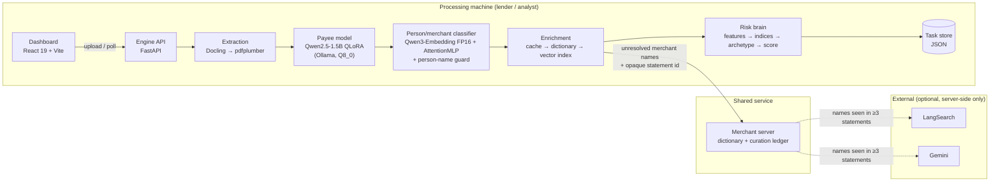

# CreditMitra — Design Document

**Project ID:** TIHI-506825 · **Status as of:** 12 October 2026 · **TRL:** 4

Companion to the Feature Specification. This document explains how the
system is built, why each major design decision was made, and what the
measurements behind those decisions were.

---

## 1. System overview

Five repositories make up the product; three more hold the research behind it.

| Repository | Role |
|---|---|
| `CreditMitra-engine` | The pipeline and API (Python, FastAPI) |
| `CreditMitra-dashboard` | Analyst UI (React, TypeScript) |
| `CreditMitra-merchant-server` | Shared merchant knowledge and its curation loop |
| `CreditMitra-finetune` | Payee model training (QLoRA and DP-QLoRA) |
| `CreditMitra-Merchant-Classification` | Person/merchant classifier research and models |
| `CreditMitra-Synthetic-Transaction-Generator` | Synthetic narration dataset for training |
| `CreditMitra-research` | Privacy audit, reviews, and these documents |

---

## 2. Processing pipeline

A statement is processed as one background task (`process_pdf_task`):

| # | Stage | Component | Output |
|---|---|---|---|
| 1 | Extract | `extraction.py`, `statement_layout.py`, `parsing.py` | Rows with parsed date, amount, direction, balance |
| 2 | Payee | `predict_payee` + `ground_payee` | Payee name per row (invented names rejected) |
| 3 | Classify | `merchant_classifier.py` | `person` / `merchant` per distinct payee |
| 4 | Enrich | `merchant_enrichment.py`, `merchant_vectors.py` | Category, lifestyle dimension, risk flag per merchant |
| 5 | Score | `feature_engineering.py` → `lifestyle_profile.py` → `archetype.py` → `credit_scorer.py` | `CreditRiskReport` |
| 6 | Persist | `task_store.py` | `data/tasks/<id>.json`; upload deleted |

Each stage degrades rather than fails: an unreachable payee model yields empty
payees, missing classifier files fall back to keyword rules, an enrichment
miss yields the `other` category, and a scoring error yields a task with
transactions and no report. Only an unreadable statement fails the task, with
the table headers it found.

### 2.1 Extraction

Docling converts the PDF (OCR off — it caused out-of-memory crashes on
multi-page statements); if it fails or finds no transactions, pdfplumber
runs. `statement_layout.py` maps headers to canonical columns by keyword, so
"Withdrawal Amt.", "Debit", and "Withdrawal Amount (INR)" all land in the same
field, and handles single-amount + Dr/Cr layouts, header-less continuation
pages and wrapped narrations.

### 2.2 Payee extraction and grounding

The payee model is prompted with a fixed instruction and the narration in raw
mode at temperature 0. Its output is accepted only if each word of 3+
characters traces back to the narration (its first ~60% must appear, which
allows expanding a truncation like "JIO RECHA" → "Jio Recharge"). Otherwise the
UPI name segment is read directly from the narration. On 486 validation
narrations no correct payee is rejected; on a real statement 13 of 220
predictions were invented and caught.

### 2.3 Classification

An embedding classifier separates people from merchants. Because it was
confidently wrong on bare and truncated personal names ("Neha" → merchant,
0.94), a guard overrides a merchant label when every word of the name is a
known Indian name word and nothing marks it as a business (keyword or
dictionary hit). The word list (5,050 words) comes from a labelled person-name
corpus plus common names, minus business words.

### 2.4 Enrichment tiers

| Tier | Where | Cost | What leaves the device |
|---|---|---|---|
| Cache (SQLite, versioned by dictionary hash; misses expire in 7 days) | Engine | ~0.1 ms | Nothing |
| Dictionary — exact alias, then longest prefix | Engine | ~0.01 ms | Nothing |
| Vector index — char n-gram TF-IDF, cosine ≥ 0.75 | Engine | < 1 ms | Nothing |
| Merchant server | Shared | one HTTP call per statement | Unresolved merchant names + opaque statement id |
| Web search + LLM (optional) | Engine or server | 1–3 s | Merchant name only |

The taxonomy (26 categories) fixes `is_essential`, `lifestyle_dim` and
`risk_flag` as a function of `category`, so a model can only ever choose the
category.

### 2.5 Risk brain

Cash-flow features and six lifestyle indices feed a two-block scorecard on
top of a base of 570: the lifestyle block (each index scored against its own
neutral anchor, with separate gain and penalty caps) and the cash-flow block
(income regularity, FOIR around a healthy 25%, balance buffer, bounces at −35
each down to −180, net cash-flow sign), clamped to ±300. All weights live in
one file, `scoring_config.py`. Archetypes are priority-ordered rules over the
features and indices (most severe first).

---

## 3. Data model

Defined once as Pydantic models (`app/schemas/statements.py`) and mirrored in
the dashboard's TypeScript types. The contract is additive-only.

- `Transaction` — raw columns, payee and classification, parsed numerics,
  enrichment fields.
- `MerchantEnrichment` — the five taxonomy fields plus canonical name.
- `FeatureVector`, `LifestyleProfile`, `ScoreFactor`, `CreditRiskReport`.
- API responses: `TaskResponse`, `TaskStatusResponse` (transactions),
  `ReportResponse` (score only — the two views never wait on each other).

---

## 4. Privacy design

| Threat | Control |
|---|---|
| Statement contents leaving the machine | All parsing, payee extraction, classification and scoring run locally; external calls carry merchant names only |
| A person's name sent out as a "merchant" | Person-name guard; only unresolved merchant names go to the server; the server proposes a name to external models only after it appears in ≥ 3 distinct statements |
| One statement resubmitted to force a name out | Statements are counted via an HMAC fingerprint under a device-local secret; the same file counts once; the server stores only a hash and cannot link it to content |
| Statements lingering on disk | Uploads deleted after processing; crash-interrupted uploads deleted at next start |
| Model memorising training narrations | DP-SGD training (ε ≈ 1.99, δ = 2.5×10⁻⁴); membership-inference AUC ≈ 0.51 across 8 attack variants (privacy audit suite) |
| A wrong high-severity label harming a borrower | No prefix or fuzzy path can produce gambling/BNPL/crypto/loan labels; automatic promotion of those needs ≥ 0.90 confidence and agreement of two LLM paths; every promotion is auditable and reversible |
| Health data lowering a score | Healthcare excluded from every ratio and index (fair lending) |

**Open items:** results JSON is not encrypted at rest; the engine has no
authentication; the served payee model is the standard adapter, not the DP
adapter.

---

## 5. Key design decisions and their evidence

| Decision | Alternatives considered | Evidence |
|---|---|---|
| Serve the payee model as Q8_0 GGUF | F16 (3.1 GB); Q4 | Q8_0: same exact-match (82.7%) as F16 on 150 validation rows, 2.4× faster per call, half the size. Ollama's own quantizer does not support Qwen2. |
| Serve the classifier embedding as FP16 | FP32 (2.4 GB); dynamic int8 | FP16 changed 0/600 labels, ~30% faster, 1.2 GB. Int8 changed 4.7% (per-tensor) and 3.2% (per-channel) of labels. |
| Character n-gram vectors for near-miss merchants | Qwen3 neural embeddings; an external vector DB | At a 0.4% false-match budget: n-grams recover 81.6% of near-miss variants vs 36.8% neural, at microseconds vs 144 ms per name. ~400 vectors → in-process brute force; a vector DB service adds operations without benefit at this scale. |
| Ground payees in the narration | Trust the model | 0/486 correct payees rejected; 13/220 invented payees caught on a real statement. |
| Count distinct statements, not requests, before any external call | Request count | Request counts can be inflated by resubmitting one statement. |
| Rebuild borderless table bodies from word positions | Rely on Docling's table detection | In Docker (Linux), Docling found no tables in a real Canara statement that it reads on Windows, with identical versions, weights and page renders. The fallback reproduces Docling's Windows output exactly (220/220). |
| `gemini-3.5-flash-lite` for curation; retry transient errors; stop on spent quota | Larger flash models; treat every failure as abstention | First live run: the original default model was retired, the API returned bursts of 503s and timeouts, and the free tier allows ~20 requests/day on the larger models. The lite model completed the run with two-path agreement. |
| Merchant server as a tier after on-device tiers | Server replaces local resolution | Local tiers resolve most names without any network call; less data leaves the device. |
| Rule-based, expert-weighted scorecard | Fitted model | No labelled outcome data exists yet; an additive scorecard is auditable and is the regulated-industry norm. Predictive validation is pending (WP4). |

---

## 6. Deployment

- **Local (analyst laptop):** `scripts/dev.ps1` starts Ollama, the engine and
  the dashboard; `docs/RUNNING.md` covers one-time setup.
- **Containers:** `deploy/docker-compose.yml` runs engine + merchant server +
  dashboard, with the payee model on host Ollama (GPU) or a containerised one.
  The engine image uses CPU-only torch; models are mounted read-only; all
  runtime state is under one volume. See `docs/DEPLOY.md`.
- **Resources:** ~3 GB RAM for the engine with the FP16 classifier; 1.6 GB for
  the payee model (GPU if available).

---

## 7. Known limitations and next steps

1. **Predictive validity.** The score is not validated against loan outcomes.
   The incremental-lift harness (null and positive controls pass) has run on
   the public PKDD'99 (Berka) dataset with a decision-time cutoff: cash flow
   alone reaches AUC 0.897, and Berka's six transaction-type categories add
   nothing (−0.026) at 63 defaults. Berka has no merchant names, so this says
   little about UPI merchant enrichment. Candidate datasets with real merchant
   categories and defaults (Alfa-Bank card transactions; Home Credit) are
   identified; Indian UPI evidence needs a lender pilot.
2. **Bank coverage.** Extraction is tested on real statements from one bank;
   other layouts on synthetic renders. A multi-bank real-statement set is needed.
3. **Long-tail merchants.** About 40% of merchant payees on a real statement
   are local shops that only the curation loop (live LangSearch + LLM) can
   resolve. The loop now runs live; on the free tier it can vet only a handful
   of names a day, and only names seen in ≥ 3 distinct statements.
4. **Deployment (TRL 5).** The containerised stack is verified end to end on a
   real statement but not yet hosted; authentication design depends on the
   hosted-service vs desktop-tool decision.
5. **DP model in serving.** The DP adapter is trained and evaluated but not yet
   the served model.
